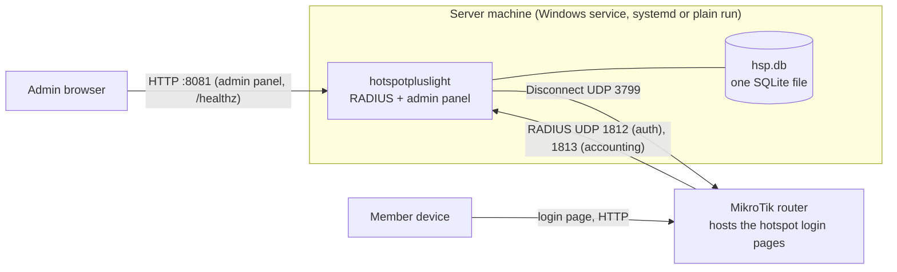
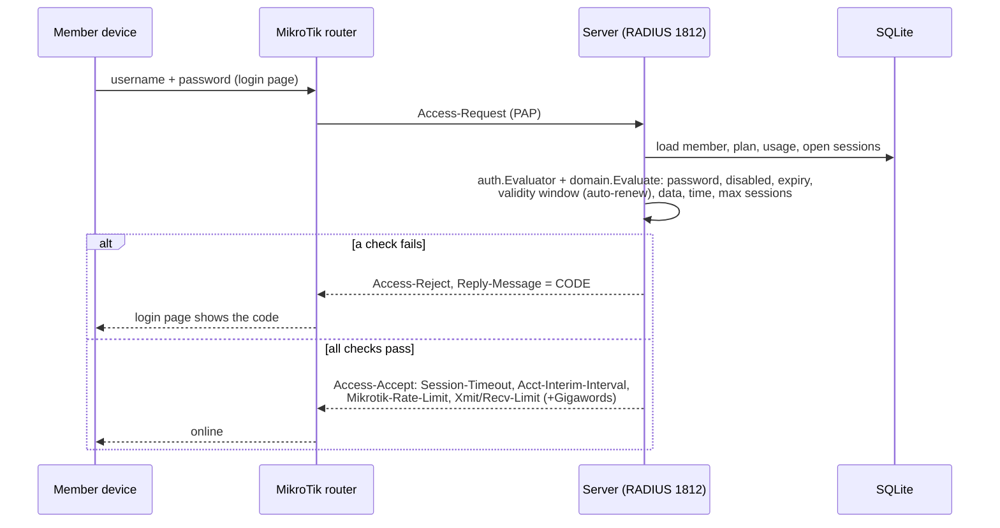
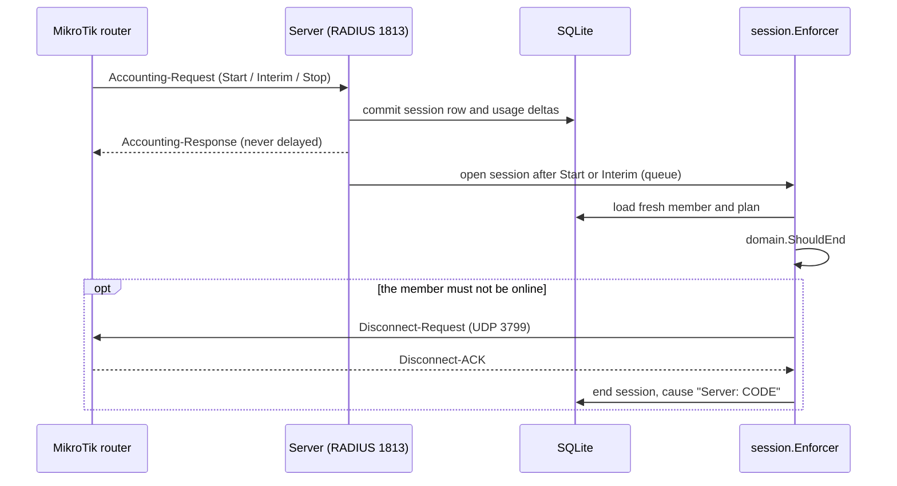
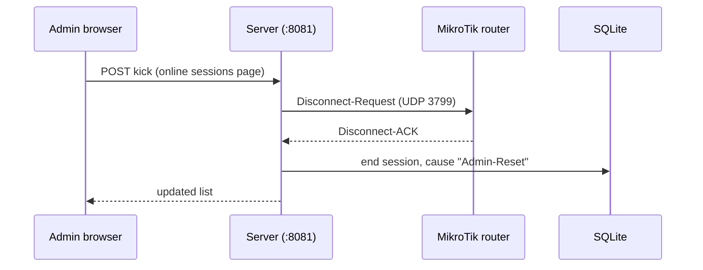
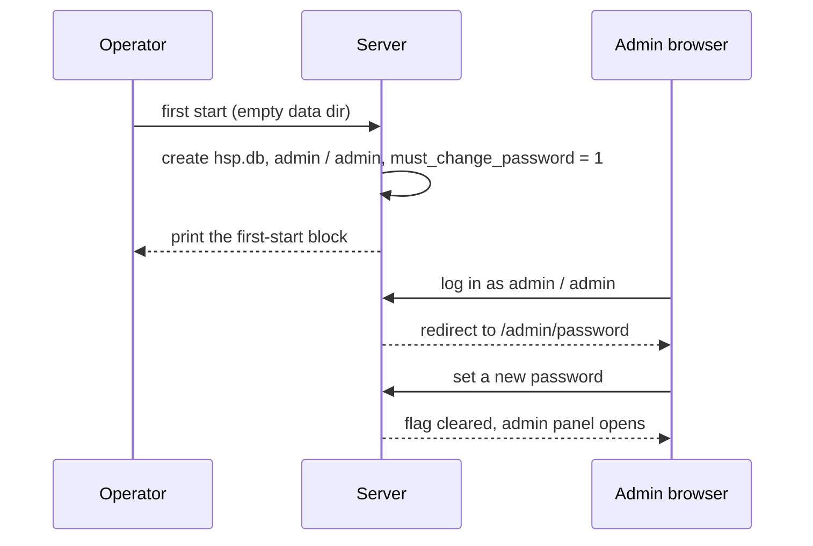

# HotspotPlus Lite

A small hotspot manager for one MikroTik router: Go, HTMX and SQLite in one binary, with a built-in RADIUS server (PAP).
It is a rewrite of HotspotPlus - https://github.com/pysf/hotspotplus - kept small: one business, one admin, one router, one database file.
The admin makes plans and members (or printable voucher batches). The server checks the limits at login and during accounting, and can kick a session.

User guides (install, router setup, login pages, backup, troubleshooting) are on the site: https://pysf.github.io/HotspotPlusLight/

This README is for developers. The public name is "HotspotPlus Lite". The binary, Go module, repo and Windows service keep the name `hotspotpluslight`.

License: GNU AGPL-3.0, see [LICENSE](LICENSE).

## Architecture



The member login pages are static HTML on the router. The server does not serve them and the pages do not call the server.
The admin panel is plain HTTP on the local network and must not be reachable from the hotspot network.

## How it works

### Member login



### Accounting and server enforcement



### Admin kick



### First admin login



## Package map

| Path | What it holds |
|---|---|
| `cmd/hotspotpluslight` | the binary: `serve`, `admin set-password`, `gen-key`, `service` (Windows), `version`; `--env-file` |
| `internal/app` | the only place that wires everything together (listeners, services, shutdown) |
| `internal/domain` | pure business rules (BR-1...BR-24): login verdict, quota, units, MAC, forms. No I/O, no clock |
| `internal/auth` | admin sessions, login throttle, the login evaluator used by RADIUS |
| `internal/member`, `internal/plan`, `internal/voucher` | member, plan and batch voucher services |
| `internal/session` | online sessions, kick, and the Enforcer (server-side Disconnect) |
| `internal/usage` | usage summary and daily history |
| `internal/radius` | RADIUS auth and accounting server, Disconnect client (`layeh.com/radius`) |
| `internal/routerpack` | the 8 hotspot folder downloads, the RouterOS setup script, built into the binary |
| `internal/linkstatus` | in-memory "last packet seen" panel on the Router page |
| `internal/settings`, `internal/config` | the single-row settings and the `HSP_*` environment |
| `internal/secret` | AES-GCM for stored member passwords |
| `internal/clock` | injected clock |
| `internal/store` | SQLite (`modernc.org/sqlite`, no CGO), forward-only migrations |
| `internal/web` | admin panel: chi handlers, templ components, own CSS and JS (no build step) |
| `e2e` | end-to-end tests that start the real binary (`harness`, `fakenas` = a fake router) |
| `perf` | capacity test (build tag `perf`) and the report writer |
| `docs` | notes per phase, design rules, perf results |

## Key decisions

| Decision | Id in PLAN.md |
|---|---|
| One business, one admin, one router, MikroTik only, PAP only | D1, D2, D3, D4 |
| Native Go RADIUS, SQLite only, no Redis or Kafka | D5, D6 |
| Member passwords are stored encrypted (AES-GCM) so the admin can view them | D8 |
| Plain HTTP on the local network | D9 |
| Login pages live on the router, no page API | D10, D20, D22 |
| English only | D19, O11 |
| Own CSS, no Tailwind, no build step | D24 |
| Two layers of limits: router attributes plus server Disconnect | O3, O4, BR-10 |
| Expiry is enforced at login | O7 |
| First login: admin / admin, then a forced password change | O15 |
| Deleting a plan that members use is blocked | O12 |
| AES-256 key auto-generated on first start (only if `hsp.db` does not exist), saved to `{DATA_DIR}/hsp.key`; back this file up with `hsp.db` | -- |
| Listen addresses and log settings: env vars seed the first start; the Settings page is the only place after that | -- |
| Time zone is a dropdown. The RADIUS secret is letters and digits only (use 20 or more); the first-start secret is generated that way | -- |

## Develop

Requires Go 1.26 (see `go.mod`). No CGO, no external services, no Node.

| Command | What it does |
|---|---|
| `make run` | build and start with data in `./data` (key auto-generated to `data/hsp.key` on first run) |
| `make reset-db` | delete the dev database in `./data` (asks first; `FORCE=1` skips; keeps `data/hsp.key`) |
| `make test` | all tests with the race detector |
| `make ci` | `go vet` and the tests |
| `make generate` | regenerate the templ components (the generated files are committed) |
| `make perf` | full capacity test, about 25-30 minutes; rewrites the Performance section below |
| `make perf-quick` | short capacity check, prints only |
| `make release VERSION=v1.2.3` | build, pack and checksum 9 platforms into `dist/` |
| `make build-cross` | cross-build the 9 platforms only (CI uses it) |

Release files have stable names without the version, so `https://github.com/pysf/HotspotPlusLight/releases/latest/download/<name>` always works:
`hotspotpluslight-<os>-<arch>.tar.gz` (`.zip` for Windows) for linux amd64, 386, arm64, arm (ARMv7); windows amd64, 386, arm64; darwin amd64, arm64, and `SHA256SUMS`.
The version is inside the binary (`hotspotpluslight version`, set with `-X main.version`).
Pushing a tag `v*` runs `.github/workflows/release.yml`, which builds these files and makes a GitHub Release.

### Tests

- The end-to-end tests in `e2e/` start the real binary and drive it only through real interfaces: UDP RADIUS, HTTP and the CLI. A fake router (`e2e/fakenas`) sends and receives the RADIUS packets.
- Tests are named `E<phase>.<nn>` and say which rules (BR-n, O-n) they cover. Each phase starts with its tests (red), then the code (green).
- Domain rules and services have unit tests with hand-written fakes. No mocking framework.

### Docs

- `PLAN.md`: the plan, decisions, business rules (BR), schema, RADIUS spec, phases. `PLAN.md` wins over other files.
- `CLAUDE.md`: context for agents working in this repo.
- `docs/`: notes per phase, `DESIGN.md` and `FRONTEND.md` (admin UI rules), `perf-results.md`.
- Hardware items still to verify on a real router are marked `VERIFY-ON-HARDWARE` in the code and in PLAN.md section 13.

## Site

The user site (landing page and docs) is in `site/`: plain HTML, CSS and small ES modules, no build step, no Node. `.github/workflows/pages.yml` deploys it to GitHub Pages on a push to `main` that changes `site/` (set Pages to the source "GitHub Actions" once in the repo settings).

Where to change the base URL: the base URL `https://pysf.github.io/HotspotPlusLight/` is written out in the `canonical`, `og:url`, `og:image` and `twitter:image` tags of every page, in `sitemap.xml` and `robots.txt`, and in the asset links of `site/404.html` (the 404 page is served at any depth, so it cannot use relative links). Every other link is relative. To use a custom domain, replace the base URL in all of `site/` in one go, for example:

```sh
grep -rl 'https://pysf.github.io/HotspotPlusLight/' site | xargs sed -i.bak 's|https://pysf.github.io/HotspotPlusLight/|https://example.com/|g'
```

This also fixes `site/404.html`: its asset links are absolute because the 404 page is served at any depth, and the page CSP only allows `self`, so on a custom domain or a local preview the 404 page loses its styles until the base URL is changed. The `sed` command above makes `.bak` backup files; delete them with `find site -name '*.bak' -delete`. The test E13.17 checks that the base URL is the same everywhere. The image `site/assets/img/og-image.png` was drawn once with headless Chrome from `reference/og-image.html`.

## Performance
The capacity test raises the number of online users step by step (500 up to 50000) and stops at the first step that fails. Run `make perf` (the full run, about 25-30 minutes): only this run rewrites this section and `docs/perf-results.md`. `make perf-quick` (short check) and runs with your own `HSP_PERF_STEPS` or `HSP_PERF_STEP_SECONDS` only print to the screen. The test never fails the build, unless you set `HSP_PERF_MIN_USERS`.

<!-- perf:start -->
Max online users on this machine: **30000** (last passing step). Run on 2026-11-04, each step 120 s after its warm-up.

Machine: OS darwin/arm64, CPU Apple M5, 10 cores, go1.26.0.

| Online users | Result | Start burst packets/s | Burst p50/p95/p99 (ms) | Steady packets/s | Auth p50/p95/p99 (ms) | Accounting p50/p95/p99 (ms) | Pages p50/p95/p99 (ms) | Lost | Server CPU % | Server RSS MB | DB MB |
|---|---|---|---|---|---|---|---|---|---|---|---|
| 500 | pass | 17 | 3.2/6.5/8.2 | 9 | 2.6/4.0/6.9 | 1.6/3.1/3.6 | 3.2/5.7/7.0 | 0 | 2 | 32 | 4.4 |
| 1000 | pass | 34 | 2.3/3.2/3.5 | 17 | 1.9/2.7/2.8 | 1.4/2.1/2.5 | 2.8/6.5/6.7 | 0 | 4 | 33 | 4.6 |
| 2000 | pass | 68 | 2.3/3.1/3.6 | 34 | 1.5/2.6/2.9 | 1.2/1.9/2.4 | 3.1/7.2/8.2 | 0 | 7 | 34 | 5.0 |
| 5000 | pass | 170 | 1.8/3.1/3.5 | 86 | 1.0/2.0/2.5 | 1.3/1.9/2.4 | 5.2/12.1/21.3 | 0 | 17 | 36 | 6.2 |
| 10000 | pass | 340 | 1.6/2.3/3.1 | 172 | 0.9/1.7/2.1 | 1.8/3.1/3.6 | 7.6/13.5/16.4 | 0 | 30 | 40 | 8.1 |
| 20000 | pass | 513 | 1.2/3.1/4.4 | 343 | 0.9/1.7/2.1 | 2.2/3.9/4.7 | 14.2/24.2/25.0 | 0 | 50 | 41 | 12.2 |
| 30000 | pass | 517 | 1.3/37.7/114.3 | 513 | 0.7/1.5/2.0 | 2.4/4.3/5.3 | 18.7/25.2/42.2 | 0 | 61 | 44 | 16.1 |
| 40000 | FAIL | 519 | 1.4/889.0/1437.7 | 681 | 0.7/1.6/2.0 | 2.5/4.7/5.9 | 21.8/139.6/657.8 | 144 | 69 | 48 | 21.1 |

Step 40000 failed: 144 replies lost or later than 1 s; the load generator itself fell behind: dispatch lag 1.275s > 1s.

Full report and explanation: [docs/perf-results.md](docs/perf-results.md).
<!-- perf:end -->
