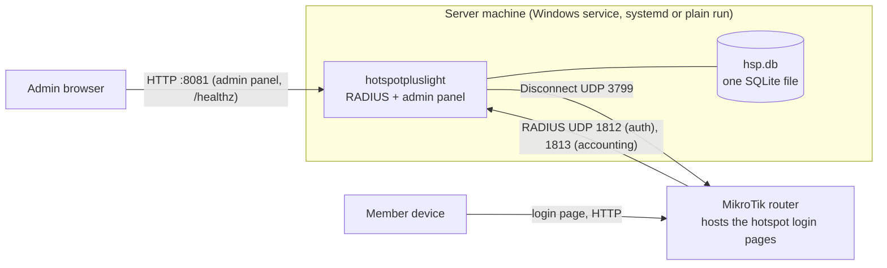
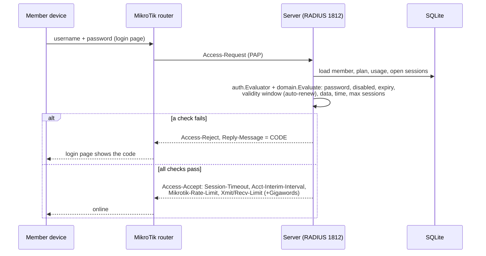
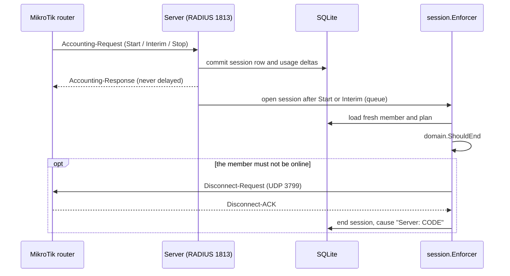
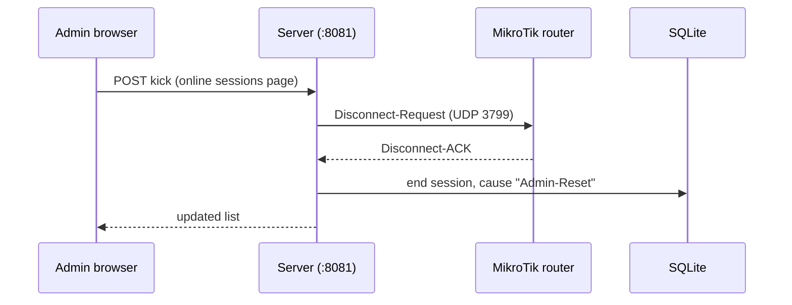
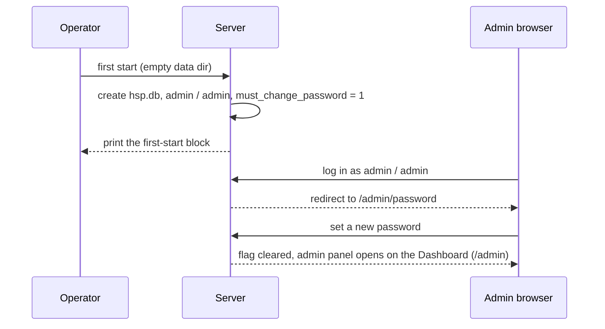

# HotspotPlus Lite

A small hotspot manager for one MikroTik router: Go, HTMX and SQLite in one binary, with a built-in RADIUS server (PAP).
It is a small rewrite of HotspotPlus (https://github.com/pysf/hotspotplus): one business, one admin, one router, one database file.
The admin creates plans and members (or batches of printable vouchers). The server checks the limits at login and during accounting. It can also kick a session.

User guides (install, router setup, login pages, backup, troubleshooting) are on the site: https://pysf.github.io/HotspotPlusLight/

This README is for developers. The public name is "HotspotPlus Lite". The binary, Go module and repo keep the name `hotspotpluslight`. The Windows service is named `HotspotPlusLight`.

License: GNU AGPL-3.0, see [LICENSE](LICENSE).

## Architecture



The member login pages are static HTML on the router. The server does not serve them and the pages do not call the server.
The admin panel is plain HTTP on the local network and must not be reachable from the hotspot network.

## How it works

### Member login



### Accounting and server enforcement



### Admin kick



### First admin login



### Update check

A background job asks the GitHub API for the latest release 30 seconds after the start and then once a day. It sends only a `User-Agent` header with the version. The answer (latest version, release notes link, time, last error) is saved in the settings row. When a newer release exists, every admin page shows "Version X is available" with a link to the **Updates** page (`/admin/update`), which also has a **Check now** button. The **Check for updates** switch on the **Settings** page turns it all off: then the server never calls GitHub. A development build (version `dev`) never checks. `HSP_UPDATE_API_URL` changes the API address (tests and mirrors).

### Update from the admin page

When a newer version exists and the program can update itself, the **Updates** page has an **Update now** button (`POST /admin/update/install`). After the admin confirms, one background job runs these steps and the page shows them (`GET /admin/update/progress`, polled every 2 seconds): it asks GitHub again for the latest release, downloads the file for this OS and CPU and `SHA256SUMS` from the same release, checks the hash, unpacks the program next to the running one (`<program>.new`), copies the database with `VACUUM INTO` to `hsp.db.bak-<old version>` in the data folder, then renames the running program to `<program>.old` and the new one to the real name, and asks the program to restart. Only one install runs at a time (a second one answers 409). A wrong or missing hash stops everything and changes nothing. The button is replaced by a reason when this is a development or test build, the release has no file for this system, the program file is not writable, or checks are off. Downloads must use https (the `HSP_UPDATE_API_URL` override also allows http, for tests). Limits: 200 MiB for the archive, 1 MiB for `SHA256SUMS`, 10 minutes in total. The state file `update-pending.json` is written in the data folder just before the swap. Then the program restarts: under a Windows service or systemd it exits with code 75 after a clean shutdown and the service manager starts the new file (the Windows install sets "restart on failure"; systemd needs `Restart=always` or `Restart=on-failure`); when started by hand it first checks that the new file runs (`version`), shuts down so the ports are free, and starts the new file as a detached child with the same arguments. If the new file does not run, the old program keeps running and the page says to restart by hand. macOS is manual only.

### Automatic rollback

Right at the start (before the database is opened) the program reads `update-pending.json`. If this is the new version, it counts the start (`tries`) and waits until its own `/healthz` answers; then it deletes the file (three tries, 200 ms apart, an error in the log if that fails) and logs "update finished". If it is not healthy within 60 seconds, or it started twice already without becoming healthy (the third start rolls back), the update is rolled back. There is no age limit: a healthy new version is never rolled back later. A clean stop (SIGTERM, Ctrl+C, service stop) during the 60 seconds is on purpose and does not count as a failed start. The rollback does the database first and the program file last (the last rename is the commit point): the backup is copied to `hsp.db.restore` and synced, the bad database is moved to `hsp.db.failed-<new version>` (the WAL files are removed), the copy is renamed to `hsp.db`, then the new program file is renamed to `<program>.bad` and `<program>.old` is renamed back. A run that stopped half way can start again safely. Then `update-rolled-back.json` is written and the old program is started. If the rollback itself cannot be done, the error is logged, the state file is deleted, a note is left ("the old version could not be put back") and the program starts as it is, so there is never a loop. The admin sees "The last update to vX failed and was rolled back (reason)" on every page until it is dismissed (`POST /admin/update/dismiss`). Data that changed after the backup is lost. A start of any other version deletes a leftover state file. Before the swap the installer runs the new file with `version`; if that fails nothing is changed. If the restart fails after the swap, the swap is undone. No install starts while `update-pending.json` exists. After a restart the Updates page reloads itself when the new process answers. On a Windows service, a database copy that takes more than about 30 seconds can hit the service start timeout (error 1053); only very large databases are affected.

### Dashboard

The admin home page (`/admin`) shows:

- four tiles: **Online now**, **Peak today**, **Traffic today** and **Failed logins today**
- the router status panel on the Dashboard, called the Router link card (last login request, accounting packet and Disconnect; moved here from the Router page)
- a short Needs attention list (members expiring in 3 days, members at 80% of their data)
- three charts (traffic for 14 days, busy hours, active members per day)

The whole page refreshes by itself every 10 seconds.

**Failed logins** are counted per day and reason code, one count for every Access-Reject the server sends. No user names and no addresses are stored. A router retry of the same request counts once. Packets the server does not answer (for example, a wrong shared secret) are not counted here. The router status panel counts those. The server keeps the counts for the session retention days (the **Keep finished sessions (days)** setting on the **Settings** page; 90 by default, 0 = forever). It deletes them together with the old sessions. The "Dashboard" page on the site explains each number.

## Package map

| Path | What it holds |
|---|---|
| `cmd/hotspotpluslight` | the binary: `serve`, `admin set-password`, `gen-key`, `service` (Windows), `version`; `--env-file` |
| `internal/app` | the only place that wires everything together (listeners, services, shutdown) |
| `internal/domain` | pure business rules (BR-1...BR-30): login verdict, quota, units, MAC, forms. No I/O, no clock |
| `internal/auth` | admin sessions, login throttle, the login evaluator used by RADIUS |
| `internal/member`, `internal/plan`, `internal/voucher` | member, plan and batch voucher services |
| `internal/session` | online sessions, kick, and the Enforcer (server-side Disconnect) |
| `internal/usage` | usage summary and daily history |
| `internal/radius` | RADIUS auth and accounting server, Disconnect client (`layeh.com/radius`) |
| `internal/routerpack` | the 8 hotspot folder downloads, the RouterOS setup script, built into the binary |
| `internal/linkstatus` | in-memory "last packet seen" data for the router status panel on the Dashboard |
| `internal/update` | update check: asks GitHub for the latest release once a day and keeps the answer; the Installer downloads, checks, backs up and swaps the program file; Recover, Rollback and the restart helpers handle a new version that does not start |
| `internal/dashboard` | read service for the Dashboard numbers (online, traffic, failed logins, attention lists, charts) |
| `internal/settings`, `internal/config` | the single-row settings and the `HSP_*` environment |
| `internal/secret` | AES-GCM for stored member passwords |
| `internal/clock` | injected clock |
| `internal/store` | SQLite (`modernc.org/sqlite`, no CGO), forward-only migrations |
| `internal/web` | admin panel: chi handlers, templ components, own CSS and JS (no build step) |
| `e2e` | end-to-end tests that start the real binary (`harness`, `fakenas` = a fake router) |
| `perf` | capacity test (build tag `perf`) and the report writer |
| `docs` | notes per phase, design rules, perf results |

## Key decisions

| Decision | Id in PLAN.md |
|---|---|
| One business, one admin, one router, MikroTik only, PAP only | D1, D2, D3, D4 |
| Native Go RADIUS, SQLite only, no Redis or Kafka | D5, D6 |
| Member passwords are stored encrypted (AES-GCM) so the admin can view them | D8 |
| Plain HTTP on the local network | D9 |
| Login pages live on the router, no page API | D10, D20, D22 |
| English only | D19, O11 |
| Own CSS, no Tailwind, no build step | D24 |
| Two layers of limits: router attributes plus server Disconnect | O3, O4, BR-10 |
| Expiry is enforced at login | O7 |
| First login: admin / admin, then a forced password change (with an optional new user name); the admin panel then opens on the Dashboard. The user name can be changed later on the Password and username page | O15, D25, BR-28 |
| Failed logins are counted per day and reason, with counts only (no user names, no addresses), kept for the session retention days | D27 |
| Deleting a plan that members use is blocked | O12 |
| The AES-256 secret key is created automatically at the first start (only if `hsp.db` does not exist) and saved to `{DATA_DIR}/hsp.key`. Back up this file with `hsp.db` | -- |
| Listen addresses and log settings: environment variables seed the first start. After that, only the Settings page changes them | -- |
| Time zone is a dropdown. The RADIUS shared secret is letters and digits only (use 20 or more). The server creates the first-start shared secret the same way | -- |

## Develop

Requires Go 1.26 (see `go.mod`). No CGO, no external services, no Node.

| Command | What it does |
|---|---|
| `make run` | build and start with data in `./data` (the secret key is created automatically in `data/hsp.key` at the first start) |
| `make reset-db` | delete the dev database in `./data` (asks first; `FORCE=1` skips; keeps `data/hsp.key`) |
| `make test` | all tests with the race detector |
| `make ci` | `go vet` and the tests |
| `make generate` | regenerate the templ components (the generated files are committed) |
| `make perf` | full capacity test, about 25-30 minutes; rewrites the Performance section below |
| `make perf-quick` | short capacity check, prints only |
| `make release VERSION=v1.2.3` | build, pack and checksum 9 platforms into `dist/` |
| `make build-cross` | cross-build the 9 platforms only (CI uses it) |

Release files have stable names without the version, so `https://github.com/pysf/HotspotPlusLight/releases/latest/download/<name>` always works:
`hotspotpluslight-<os>-<arch>.tar.gz` (`.zip` for Windows) for linux amd64, 386, arm64, arm (ARMv7); windows amd64, 386, arm64; darwin amd64, arm64, and `SHA256SUMS`.
The version is inside the binary (`hotspotpluslight version`, set with `-X main.version`).
Pushing a tag `v*` runs `.github/workflows/release.yml`, which builds these files and makes a GitHub Release.
You do not tag by hand: when `ci` is green on `main`, `.github/workflows/autorelease.yml` reads the commit messages since the last tag and, if needed, tags the commit and calls `release.yml`.

### Commit messages

Use conventional commits: `type(scope)?!?: text`. `fix:` makes a patch release, `feat:` a minor release, and `type!:` or a `BREAKING CHANGE:` line in the body makes a major release. `docs`, `chore`, `test`, `site`, `ci`, `refactor`, `build`, `style` and `perf` make no release. The `ci` workflow warns (it never fails) when the last subject does not follow this form.

### Tests

- The end-to-end tests in `e2e/` start the real binary and drive it only through real interfaces: UDP RADIUS, HTTP and the CLI. A fake router (`e2e/fakenas`) sends and receives the RADIUS packets.
- Tests are named `E<phase>.<nn>` and say which rules (BR-n, O-n) they cover. Each phase starts with its tests (red), then the code (green).
- Domain rules and services have unit tests with hand-written fakes. No mocking framework.

### Docs

- `PLAN.md`: the plan, decisions, business rules (BR), schema, RADIUS spec, phases. `PLAN.md` wins over other files.
- `CLAUDE.md`: context for agents working in this repo.
- `docs/`: notes per phase, `DESIGN.md` and `FRONTEND.md` (admin UI rules), `perf-results.md`.
- Any new RouterOS detail that is not yet checked on a real router is marked `VERIFY-ON-HARDWARE` in the code. The first hardware check list (PLAN.md section 13) was done on 2026-11-09.

## Site

The user site (landing page and docs) is in `site/`: plain HTML, CSS and small ES modules, no build step, no Node. `.github/workflows/pages.yml` deploys it to GitHub Pages on each push to `main` that changes `site/`. Do this once in the repo settings: set the Pages source to "GitHub Actions".

Where to change the base URL: the base URL `https://pysf.github.io/HotspotPlusLight/` is written out in the `canonical`, `og:url`, `og:image` and `twitter:image` tags of every page, in `sitemap.xml` and `robots.txt`, and in the asset links of `site/404.html`. (The 404 page is served at any depth, so it cannot use relative links.) Every other link is relative. To use a custom domain, replace the base URL in all of `site/` in one go. For example:

```sh
grep -rl 'https://pysf.github.io/HotspotPlusLight/' site | xargs sed -i.bak 's|https://pysf.github.io/HotspotPlusLight/|https://example.com/|g'
```

This also fixes `site/404.html`. Its asset links are absolute, and the page CSP only allows `self`. So on a custom domain or a local preview, the 404 page has no styles until you change the base URL. The `sed` command above makes `.bak` backup files. Delete them with `find site -name '*.bak' -delete`. The test E13.17 checks that the base URL is the same everywhere. The image `site/assets/img/og-image.png` was drawn once with headless Chrome from `reference/og-image.html`.

## Performance
The capacity test raises the number of online users step by step (from 500 up to 50,000). It stops at the first step that fails. Run `make perf` for the full run (about 25-30 minutes). Only this run rewrites this section and `docs/perf-results.md`. `make perf-quick` (a short check) and runs with your own `HSP_PERF_STEPS` or `HSP_PERF_STEP_SECONDS` only print to the screen. The test never fails the build unless you set `HSP_PERF_MIN_USERS`.

<!-- perf:start -->
Max online users on this machine: **30000** (last passing step). Run on 2026-11-04, each step 120 s after its warm-up.

Machine: OS darwin/arm64, CPU Apple M5, 10 cores, go1.26.0.

| Online users | Result | Start burst packets/s | Burst p50/p95/p99 (ms) | Steady packets/s | Auth p50/p95/p99 (ms) | Accounting p50/p95/p99 (ms) | Pages p50/p95/p99 (ms) | Lost | Server CPU % | Server RSS MB | DB MB |
|---|---|---|---|---|---|---|---|---|---|---|---|
| 500 | pass | 17 | 3.2/6.5/8.2 | 9 | 2.6/4.0/6.9 | 1.6/3.1/3.6 | 3.2/5.7/7.0 | 0 | 2 | 32 | 4.4 |
| 1000 | pass | 34 | 2.3/3.2/3.5 | 17 | 1.9/2.7/2.8 | 1.4/2.1/2.5 | 2.8/6.5/6.7 | 0 | 4 | 33 | 4.6 |
| 2000 | pass | 68 | 2.3/3.1/3.6 | 34 | 1.5/2.6/2.9 | 1.2/1.9/2.4 | 3.1/7.2/8.2 | 0 | 7 | 34 | 5.0 |
| 5000 | pass | 170 | 1.8/3.1/3.5 | 86 | 1.0/2.0/2.5 | 1.3/1.9/2.4 | 5.2/12.1/21.3 | 0 | 17 | 36 | 6.2 |
| 10000 | pass | 340 | 1.6/2.3/3.1 | 172 | 0.9/1.7/2.1 | 1.8/3.1/3.6 | 7.6/13.5/16.4 | 0 | 30 | 40 | 8.1 |
| 20000 | pass | 513 | 1.2/3.1/4.4 | 343 | 0.9/1.7/2.1 | 2.2/3.9/4.7 | 14.2/24.2/25.0 | 0 | 50 | 41 | 12.2 |
| 30000 | pass | 517 | 1.3/37.7/114.3 | 513 | 0.7/1.5/2.0 | 2.4/4.3/5.3 | 18.7/25.2/42.2 | 0 | 61 | 44 | 16.1 |
| 40000 | FAIL | 519 | 1.4/889.0/1437.7 | 681 | 0.7/1.6/2.0 | 2.5/4.7/5.9 | 21.8/139.6/657.8 | 144 | 69 | 48 | 21.1 |

Step 40000 failed: 144 replies lost or later than 1 s; the load generator itself fell behind: dispatch lag 1.275s > 1s.

Full report and explanation: [docs/perf-results.md](docs/perf-results.md).
<!-- perf:end -->
